# SCHEMA.md — PostgreSQL schema (3NF)

Status: Phase 1 design. Implement exactly as written (Django models + migrations). Deviations go
to PROGRESS.md first.

Conventions
- PK: `id BIGINT GENERATED ALWAYS AS IDENTITY` (Django `BigAutoField`). See decision D1.
- Every table has `created_at TIMESTAMPTZ NOT NULL DEFAULT now()` and (unless marked append-only)
  `updated_at TIMESTAMPTZ NOT NULL`. Not repeated below.
- Status/enum columns are `VARCHAR(32)` with a `CHECK (col IN (...))`. See decision D14.
- Money: `NUMERIC(18,2)` + sibling `*_currency_code CHAR(3) REFERENCES currencies`. Rates `NUMERIC(20,10)`.
- `*_user_id` → `users(id)`, `*_organization_id` → `organizations(id)` unless stated.
- FK delete rule is `RESTRICT` (Django `PROTECT`) unless stated; `CASCADE` only for pure children
  (line items, chat participants, dispute events, request services).
- Soft delete (`deleted_at TIMESTAMPTZ NULL`) only on `organizations`, `vessels`, `users`. See D13.

---

## 1. ER diagram

```mermaid
erDiagram
  users ||--o| organization_members : "member of"
  organizations ||--o{ organization_members : has
  organizations ||--o| owner_profiles : "if OWNER"
  organizations ||--o| agent_profiles : "if AGENT"
  organizations ||--o| merchant_profiles : "if MERCHANT"
  organizations ||--o{ organization_locations : serves
  organizations ||--o{ organization_ports : serves
  organizations ||--o{ organization_services : offers
  organizations ||--o{ verification_documents : uploads
  stored_files ||--o{ verification_documents : file

  countries ||--o{ locations : has
  locations ||--o{ ports : has
  locations ||--o{ organization_locations : ""
  ports ||--o{ organization_ports : ""
  service_categories ||--o{ organization_services : ""

  organizations ||--o{ vessels : owns
  countries ||--o{ vessels : flag

  users ||--o{ requests : "from_user"
  organizations ||--o{ requests : "from_org / to_org"
  request_role_policies }o..o{ requests : "allowed pairs"
  requests ||--o| port_call_request_details : "PORT_CALL detail"
  requests ||--o{ request_services : needs
  service_categories ||--o{ request_services : ""
  requests ||--o| port_calls : "accepted → creates"
  port_calls ||--o{ requests : "VENDOR_SERVICE requests"

  vessels ||--o{ port_calls : ""
  ports ||--o{ port_calls : ""
  cargo_types ||--o{ port_calls : ""
  organizations ||--o{ port_calls : "owner_org / agent_org"

  port_calls ||--o{ disbursement_accounts : "PDA/FDA versions"
  disbursement_accounts ||--o{ disbursement_line_items : contains
  disbursement_line_items |o--o{ disbursement_line_items : "FDA line → PDA line"
  service_categories ||--o{ disbursement_line_items : category
  fx_rates |o--o{ disbursement_line_items : "rate used"
  vendor_invoices |o--o| disbursement_line_items : "backs FDA line"

  port_calls ||--o{ vendor_invoices : ""
  organizations ||--o{ vendor_invoices : "vendor"
  requests |o--o{ vendor_invoices : "vendor request"
  vendor_invoices ||--o{ vendor_invoice_lines : ""
  stored_files |o--o{ vendor_invoices : file

  port_calls ||--o{ payments : ""
  disbursement_accounts |o--o{ payments : "against PDA/FDA"
  settlements |o--o{ payments : "balance / refund"
  fx_rates |o--o{ payments : ""
  port_calls ||--o| settlements : ""
  disbursement_accounts ||--o| settlements : "final FDA"

  disbursement_line_items ||--o{ disputes : "FDA line"
  disputes ||--o{ dispute_events : history
  disbursement_line_items |o--o{ disputes : "resolved by line"

  port_calls ||--o{ chat_threads : "PORT_CALL thread"
  requests |o--o{ chat_threads : "VENDOR_SERVICE thread"
  chat_threads ||--o{ chat_participants : ""
  chat_threads ||--o{ chat_messages : ""
  chat_threads ||--o{ chat_read_receipts : ""
  stored_files |o--o{ chat_messages : attachment

  port_calls ||--o{ ratings : ""
  organizations ||--o{ ratings : "rater / ratee"

  port_calls ||--o{ generated_documents : ""
  stored_files ||--o{ generated_documents : ""
  users |o--o{ audit_log : actor
```

---

## 2. Tables

### 2.1 Identity & organizations

#### `users`
| column | type | constraints |
|---|---|---|
| id | BIGINT | PK |
| firebase_uid | VARCHAR(128) | NULL (pre-provisioned users until first sign-in); UNIQUE where not null |
| email | CITEXT | NOT NULL, UNIQUE |
| email_verified | BOOLEAN | NOT NULL DEFAULT false |
| display_name | VARCHAR(200) | NOT NULL DEFAULT '' |
| photo_url | TEXT | NULL |
| role | VARCHAR(16) | NULL; CHECK IN (ADMIN, OWNER, AGENT, MERCHANT) |
| status | VARCHAR(16) | NOT NULL DEFAULT 'NEW'; CHECK IN (NEW, ONBOARDING, PENDING_REVIEW, APPROVED, REJECTED, SUSPENDED) |
| status_reason | TEXT | NULL (rejection/suspension reason shown to user) |
| status_changed_at | TIMESTAMPTZ | NULL |
| status_changed_by_user_id | BIGINT | NULL FK users |
| last_login_at | TIMESTAMPTZ | NULL |
| deleted_at | TIMESTAMPTZ | NULL |

Constraints: `CHECK (role IS NOT NULL OR status = 'NEW')`; `CHECK (role <> 'ADMIN' OR status IN ('APPROVED','SUSPENDED'))`.
Indexes: `(status, role)`; partial unique `firebase_uid WHERE firebase_uid IS NOT NULL`.
Django: custom `AbstractBaseUser` with unusable password; `is_staff` derived from role=ADMIN for the Django admin site.

#### `organizations`
| column | type | constraints |
|---|---|---|
| id | BIGINT | PK |
| type | VARCHAR(16) | NOT NULL; CHECK IN (OWNER, AGENT, MERCHANT) |
| legal_name | VARCHAR(200) | NOT NULL |
| trade_name | VARCHAR(200) | NOT NULL DEFAULT '' |
| registration_number | VARCHAR(100) | NOT NULL DEFAULT '' |
| tax_id | VARCHAR(100) | NOT NULL DEFAULT '' |
| email | CITEXT | NOT NULL DEFAULT '' |
| phone | VARCHAR(40) | NOT NULL DEFAULT '' |
| website | VARCHAR(255) | NOT NULL DEFAULT '' |
| address_line1 / address_line2 | VARCHAR(200) | NOT NULL DEFAULT '' |
| city | VARCHAR(100) | NOT NULL DEFAULT '' |
| postal_code | VARCHAR(20) | NOT NULL DEFAULT '' |
| country_code | CHAR(2) | NOT NULL FK countries |
| verification_status | VARCHAR(16) | NOT NULL DEFAULT 'DRAFT'; CHECK IN (DRAFT, PENDING_REVIEW, APPROVED, REJECTED, SUSPENDED) |
| verification_note | TEXT | NULL |
| verified_at | TIMESTAMPTZ | NULL |
| verified_by_user_id | BIGINT | NULL FK users |
| submitted_at | TIMESTAMPTZ | NULL |
| created_by_user_id | BIGINT | NULL FK users (admin who created it, or the onboarding user) |
| deleted_at | TIMESTAMPTZ | NULL |

Indexes: `(type, verification_status)`; `legal_name` (btree, for sort/search); partial unique `(type, lower(legal_name)) WHERE deleted_at IS NULL`.

#### `organization_members`
| column | type | constraints |
|---|---|---|
| id | BIGINT | PK |
| organization_id | BIGINT | NOT NULL FK organizations |
| user_id | BIGINT | NOT NULL FK users |
| is_primary_contact | BOOLEAN | NOT NULL DEFAULT true |
| joined_at | TIMESTAMPTZ | NOT NULL DEFAULT now() |

Constraints: `UNIQUE (organization_id, user_id)`; **`UNIQUE (user_id)` (v1: one org per user — dropping this constraint enables multi-org users, see D2)**; partial unique `(organization_id) WHERE is_primary_contact`.

#### `owner_profiles` (1:1 organizations where type=OWNER)
| column | type | constraints |
|---|---|---|
| organization_id | BIGINT | PK, FK organizations ON DELETE CASCADE |
| operator_kind | VARCHAR(16) | NOT NULL DEFAULT 'OWNER'; CHECK IN (OWNER, OPERATOR, CHARTERER, MANAGER) |
| fleet_size | INTEGER | NULL, CHECK >= 0 |
| preferred_currency_code | CHAR(3) | NOT NULL DEFAULT 'USD' FK currencies |
| notes | TEXT | NOT NULL DEFAULT '' |

#### `agent_profiles` (1:1 organizations where type=AGENT)
| column | type | constraints |
|---|---|---|
| organization_id | BIGINT | PK, FK organizations ON DELETE CASCADE |
| description | TEXT | NOT NULL DEFAULT '' |
| emergency_phone | VARCHAR(40) | NOT NULL DEFAULT '' |
| default_agency_fee_amount | NUMERIC(18,2) | NULL |
| default_agency_fee_currency_code | CHAR(3) | NULL FK currencies |
| rating_avg | NUMERIC(3,2) | NOT NULL DEFAULT 0; CHECK 0..5 — **denormalized** (D16) |
| rating_count | INTEGER | NOT NULL DEFAULT 0 — **denormalized** |
| completed_port_calls | INTEGER | NOT NULL DEFAULT 0 — **denormalized** |

CHECK: `(default_agency_fee_amount IS NULL) = (default_agency_fee_currency_code IS NULL)`.

#### `merchant_profiles` (1:1 organizations where type=MERCHANT)
| column | type | constraints |
|---|---|---|
| organization_id | BIGINT | PK, FK organizations ON DELETE CASCADE |
| description | TEXT | NOT NULL DEFAULT '' |
| catalog_notes | TEXT | NOT NULL DEFAULT '' (free text on cargo/goods offered) |
| default_currency_code | CHAR(3) | NOT NULL DEFAULT 'INR' FK currencies |
| rating_avg | NUMERIC(3,2) | NOT NULL DEFAULT 0 — denormalized, unused until agent→merchant ratings |
| rating_count | INTEGER | NOT NULL DEFAULT 0 |

A DB trigger is **not** used to enforce "profile type matches organization.type"; the service layer
creates the matching profile in the same transaction and a test asserts it (D3).

#### `organization_locations` / `organization_ports` / `organization_services`
| table | columns | constraints |
|---|---|---|
| organization_locations | id, organization_id, location_id | UNIQUE (organization_id, location_id) |
| organization_ports | id, organization_id, port_id | UNIQUE (organization_id, port_id); index `(port_id)` for discovery |
| organization_services | id, organization_id, service_category_id, notes TEXT DEFAULT '' | UNIQUE (organization_id, service_category_id); index `(service_category_id)` |

#### `verification_documents`
| column | type | constraints |
|---|---|---|
| id | BIGINT | PK |
| organization_id | BIGINT | NOT NULL FK organizations |
| uploaded_by_user_id | BIGINT | NOT NULL FK users |
| document_type | VARCHAR(32) | NOT NULL; CHECK IN (COMPANY_REGISTRATION, TAX_CERTIFICATE, TRADE_LICENSE, ID_PROOF, BANK_PROOF, OTHER) |
| title | VARCHAR(200) | NOT NULL DEFAULT '' |
| file_id | BIGINT | NOT NULL FK stored_files |
| status | VARCHAR(16) | NOT NULL DEFAULT 'PENDING'; CHECK IN (PENDING, APPROVED, REJECTED) |
| review_note | TEXT | NULL |
| reviewed_by_user_id | BIGINT | NULL FK users |
| reviewed_at | TIMESTAMPTZ | NULL |
| review_source | VARCHAR(16) | NOT NULL DEFAULT 'HUMAN'; CHECK IN (HUMAN, AUTOMATED) — future AI verification |
| review_metadata | JSONB | NOT NULL DEFAULT '{}' |

Indexes: `(organization_id, status)`.

### 2.2 Master data

#### `countries`
`code CHAR(2) PK` (ISO 3166-1 alpha-2), `iso3 CHAR(3) NOT NULL UNIQUE`, `name VARCHAR(100) NOT NULL`, `is_active BOOLEAN DEFAULT true`.

#### `locations`
| column | type | constraints |
|---|---|---|
| id | BIGINT | PK |
| country_code | CHAR(2) | NOT NULL FK countries |
| name | VARCHAR(120) | NOT NULL (city/region, e.g. "Mumbai") |
| region | VARCHAR(120) | NOT NULL DEFAULT '' (state/province) |
| is_active | BOOLEAN | NOT NULL DEFAULT true |

UNIQUE `(country_code, lower(name))`.

#### `ports`
| column | type | constraints |
|---|---|---|
| id | BIGINT | PK |
| location_id | BIGINT | NOT NULL FK locations |
| name | VARCHAR(150) | NOT NULL |
| unlocode | CHAR(5) | NULL; partial UNIQUE WHERE NOT NULL (e.g. INBOM, SGSIN) |
| timezone | VARCHAR(64) | NOT NULL (IANA, e.g. Asia/Kolkata) |
| latitude / longitude | NUMERIC(9,6) | NULL |
| is_active | BOOLEAN | NOT NULL DEFAULT true |

UNIQUE `(location_id, lower(name))`.

#### `service_categories`
| column | type | constraints |
|---|---|---|
| id | BIGINT | PK |
| code | VARCHAR(40) | NOT NULL UNIQUE (PORT_DUES, PILOTAGE, TOWAGE, BERTH_HIRE, MOORING, CUSTOMS_CLEARANCE, IMMIGRATION, FRESH_WATER, PROVISIONS, BUNKERS, CREW_CHANGE, CASH_TO_MASTER, LAUNCH_SERVICE, GARBAGE_DISPOSAL, SURVEY, STEVEDORING, AGENCY_FEE, OTHER) |
| name | VARCHAR(100) | NOT NULL |
| description | TEXT | NOT NULL DEFAULT '' |
| is_vendor_service | BOOLEAN | NOT NULL DEFAULT true (merchants may offer it) |
| is_agent_fee | BOOLEAN | NOT NULL DEFAULT false (exactly one row true: AGENCY_FEE; partial UNIQUE `(is_agent_fee) WHERE is_agent_fee`) |
| sort_order | INTEGER | NOT NULL DEFAULT 0 |
| is_active | BOOLEAN | NOT NULL DEFAULT true |

One lookup serves both "cost category on PDA/FDA lines" and "service a merchant offers / a request needs" (D4).

#### `cargo_types`
`id PK`, `code VARCHAR(40) UNIQUE` (CONTAINER, DRY_BULK, LIQUID_BULK, BREAK_BULK, RORO, LNG_LPG, PROJECT, PASSENGER, BALLAST, OTHER), `name`, `is_active`.

#### `currencies`
`code CHAR(3) PK` (ISO 4217), `name VARCHAR(60)`, `symbol VARCHAR(8)`, `minor_units SMALLINT NOT NULL DEFAULT 2 CHECK 0..4`, `is_active`.

#### `fx_rates` (append-only by policy)
| column | type | constraints |
|---|---|---|
| id | BIGINT | PK |
| base_currency_code | CHAR(3) | NOT NULL FK currencies |
| quote_currency_code | CHAR(3) | NOT NULL FK currencies |
| rate | NUMERIC(20,10) | NOT NULL, CHECK > 0 — quote units per 1 base unit |
| source | VARCHAR(32) | NOT NULL; CHECK IN (MANUAL, OPEN_EXCHANGE_RATES, ECB, RBI, OTHER) |
| source_reference | VARCHAR(200) | NOT NULL DEFAULT '' (provider id / URL / memo) |
| as_of | TIMESTAMPTZ | NOT NULL (the instant the rate is valid for) |
| fetched_at | TIMESTAMPTZ | NOT NULL DEFAULT now() |
| created_by_user_id | BIGINT | NULL FK users (NULL = system job) |

Constraints: `CHECK (base_currency_code <> quote_currency_code)`; `UNIQUE (base_currency_code, quote_currency_code, source, as_of)`.
Index: `(base_currency_code, quote_currency_code, as_of DESC)` for "latest rate on/before date".
No `updated_at`; rows are never updated.

### 2.3 Vessels

#### `vessels`
| column | type | constraints |
|---|---|---|
| id | BIGINT | PK |
| owner_organization_id | BIGINT | NOT NULL FK organizations |
| name | VARCHAR(150) | NOT NULL |
| imo_number | CHAR(7) | NULL; CHECK `imo_number ~ '^[0-9]{7}$'`; partial UNIQUE WHERE NOT NULL AND deleted_at IS NULL |
| call_sign | VARCHAR(16) | NOT NULL DEFAULT '' |
| flag_country_code | CHAR(2) | NULL FK countries |
| vessel_type | VARCHAR(32) | NOT NULL; CHECK IN (BULK_CARRIER, CONTAINER, TANKER, GENERAL_CARGO, RORO, LNG_LPG, PASSENGER, OFFSHORE, OTHER) |
| grt / nrt / dwt | NUMERIC(12,2) | NULL, CHECK >= 0 |
| loa_m / beam_m / max_draft_m | NUMERIC(8,2) | NULL, CHECK >= 0 |
| deleted_at | TIMESTAMPTZ | NULL |

Partial UNIQUE `(owner_organization_id, lower(name)) WHERE deleted_at IS NULL`. Vessel type is a CHECK enum (admin never edits it); cargo type is a lookup (admin may add) — D14.

### 2.4 Generic requests

#### `request_role_policies` (policy layer — the "config, not schema" table)
| column | type | constraints |
|---|---|---|
| id | BIGINT | PK |
| request_type | VARCHAR(32) | NOT NULL; CHECK IN (PORT_CALL, VENDOR_SERVICE) |
| from_role | VARCHAR(16) | NOT NULL; CHECK IN (OWNER, AGENT, MERCHANT) |
| to_role | VARCHAR(16) | NOT NULL; CHECK IN (OWNER, AGENT, MERCHANT) |
| is_enabled | BOOLEAN | NOT NULL DEFAULT true |
| requires_port_call | BOOLEAN | NOT NULL (VENDOR_SERVICE=true, PORT_CALL=false) |
| creates_chat_thread | BOOLEAN | NOT NULL DEFAULT true |

UNIQUE `(request_type, from_role, to_role)`. Seed: (PORT_CALL, OWNER, AGENT), (VENDOR_SERVICE, AGENT, MERCHANT). Adding (VENDOR_SERVICE, MERCHANT, AGENT) later is an INSERT.

#### `requests`
| column | type | constraints |
|---|---|---|
| id | BIGINT | PK |
| reference | VARCHAR(24) | NOT NULL UNIQUE (`REQ-YYYY-NNNNNN`) |
| request_type | VARCHAR(32) | NOT NULL; CHECK IN (PORT_CALL, VENDOR_SERVICE) |
| from_user_id | BIGINT | NOT NULL FK users |
| from_organization_id | BIGINT | NOT NULL FK organizations |
| from_role | VARCHAR(16) | NOT NULL; CHECK IN (OWNER, AGENT, MERCHANT) |
| to_organization_id | BIGINT | NOT NULL FK organizations |
| to_role | VARCHAR(16) | NOT NULL; CHECK IN (OWNER, AGENT, MERCHANT) |
| to_user_id | BIGINT | NULL FK users (set to the responder on accept/decline) |
| status | VARCHAR(16) | NOT NULL DEFAULT 'PENDING'; CHECK IN (PENDING, ACCEPTED, DECLINED, WITHDRAWN, EXPIRED) |
| port_call_id | BIGINT | NULL FK port_calls — VENDOR_SERVICE: the call the service is for (set at creation). PORT_CALL: the call created on acceptance |
| subject | VARCHAR(200) | NOT NULL DEFAULT '' |
| message | TEXT | NOT NULL DEFAULT '' (free-text notes / special requirements) |
| payload | JSONB | NOT NULL DEFAULT '{}' (type-specific extras validated by per-type schema; not used for anything with an FK — see D5) |
| responded_at | TIMESTAMPTZ | NULL |
| response_note | TEXT | NOT NULL DEFAULT '' |
| expires_at | TIMESTAMPTZ | NULL |

Constraints: `CHECK (from_organization_id <> to_organization_id)`; `CHECK (request_type <> 'VENDOR_SERVICE' OR port_call_id IS NOT NULL)`; `CHECK ((status IN ('ACCEPTED','DECLINED')) = (responded_at IS NOT NULL))`.
Indexes: `(to_organization_id, status)`, `(from_organization_id, status)`, `(port_call_id)`, `(request_type, status)`.
The `from_role`/`to_role` columns duplicate `organizations.type` at the time of the request; kept so the policy check and audit are self-contained and so a request survives an org changing type (deliberate, D15).

#### `port_call_request_details` (1:1 with requests where request_type=PORT_CALL)
| column | type | constraints |
|---|---|---|
| request_id | BIGINT | PK, FK requests ON DELETE CASCADE |
| vessel_id | BIGINT | NOT NULL FK vessels |
| port_id | BIGINT | NOT NULL FK ports |
| eta | TIMESTAMPTZ | NOT NULL |
| etd | TIMESTAMPTZ | NOT NULL, CHECK etd > eta |
| cargo_type_id | BIGINT | NOT NULL FK cargo_types |
| cargo_description | VARCHAR(300) | NOT NULL DEFAULT '' |
| cargo_quantity | NUMERIC(14,3) | NULL |
| cargo_unit | VARCHAR(16) | NOT NULL DEFAULT '' (MT, TEU, m3…) |

#### `request_services` (services needed by a request, both types)
`id PK`, `request_id FK requests ON DELETE CASCADE`, `service_category_id FK service_categories`, `quantity NUMERIC(14,3) NULL`, `unit VARCHAR(16) DEFAULT ''`, `notes TEXT DEFAULT ''`. UNIQUE `(request_id, service_category_id)`.
For VENDOR_SERVICE requests this is the list of services the agent wants the merchant to quote/provide.

### 2.5 Port calls (central aggregate)

#### `port_calls`
| column | type | constraints |
|---|---|---|
| id | BIGINT | PK |
| reference | VARCHAR(24) | NOT NULL UNIQUE (`PC-YYYY-NNNNNN`) |
| request_id | BIGINT | NOT NULL UNIQUE FK requests (origin) |
| owner_organization_id | BIGINT | NOT NULL FK organizations |
| agent_organization_id | BIGINT | NOT NULL FK organizations |
| vessel_id | BIGINT | NOT NULL FK vessels |
| port_id | BIGINT | NOT NULL FK ports |
| cargo_type_id | BIGINT | NOT NULL FK cargo_types |
| status | VARCHAR(24) | NOT NULL DEFAULT 'PDA_PENDING'; CHECK IN (PDA_PENDING, PDA_SENT, PDA_APPROVED, ADVANCE_RECEIVED, IN_PORT, DEPARTED, FDA_ISSUED, DISPUTED, FDA_FINAL, SETTLED, CLOSED, CANCELLED) |
| settlement_currency_code | CHAR(3) | NOT NULL DEFAULT 'USD' FK currencies |
| eta / etd | TIMESTAMPTZ | NOT NULL, CHECK etd > eta |
| ata / atd | TIMESTAMPTZ | NULL, CHECK (atd IS NULL OR ata IS NOT NULL), CHECK (atd IS NULL OR atd >= ata) |
| berth | VARCHAR(100) | NOT NULL DEFAULT '' |
| notes | TEXT | NOT NULL DEFAULT '' |
| cancelled_reason | TEXT | NULL |
| closed_at | TIMESTAMPTZ | NULL |
| status_changed_at | TIMESTAMPTZ | NOT NULL DEFAULT now() |

Columns `owner_organization_id`, `vessel_id`, `port_id`, `cargo_type_id`, `eta`, `etd` are **copied from the request on acceptance** and then owned by the port call (the request is an immutable record of what was asked; the port call is the live operational record that the agent may update — D6).
Indexes: `(agent_organization_id, status)`, `(owner_organization_id, status)`, `(vessel_id)`, `(port_id, eta)`, `(status, eta)`.

### 2.6 Disbursement accounts (PDA & FDA share one structure — D7)

#### `disbursement_accounts`
| column | type | constraints |
|---|---|---|
| id | BIGINT | PK |
| port_call_id | BIGINT | NOT NULL FK port_calls |
| kind | CHAR(3) | NOT NULL; CHECK IN ('PDA','FDA') |
| version | SMALLINT | NOT NULL DEFAULT 1, CHECK >= 1 |
| is_current | BOOLEAN | NOT NULL DEFAULT true |
| reference | VARCHAR(32) | NOT NULL UNIQUE (`PDA-PC-2026-000123-v2`) |
| status | VARCHAR(16) | NOT NULL DEFAULT 'DRAFT'; CHECK IN (DRAFT, ISSUED, APPROVED, REJECTED, SUPERSEDED, FINAL, VOID) |
| currency_code | CHAR(3) | NOT NULL FK currencies (= port_call.settlement_currency_code) |
| total_amount | NUMERIC(18,2) | NOT NULL DEFAULT 0 — **denormalized** sum of line `amount` (D16) |
| supersedes_id | BIGINT | NULL FK disbursement_accounts (previous version) |
| prepared_by_user_id | BIGINT | NOT NULL FK users |
| issued_at | TIMESTAMPTZ | NULL |
| owner_responded_by_user_id | BIGINT | NULL FK users |
| owner_responded_at | TIMESTAMPTZ | NULL |
| owner_response_note | TEXT | NOT NULL DEFAULT '' |
| finalized_at | TIMESTAMPTZ | NULL (FDA only) |
| fx_policy_note | TEXT | NOT NULL DEFAULT '' (FDA: how rates were chosen, human-readable) |
| notes | TEXT | NOT NULL DEFAULT '' (printed on the PDF) |

Constraints:
- `UNIQUE (port_call_id, kind, version)`
- partial `UNIQUE (port_call_id, kind) WHERE is_current` — exactly one current PDA and one current FDA per call
- `CHECK (kind = 'PDA' OR status NOT IN ('APPROVED','REJECTED'))` — only PDAs get owner approve/reject
- `CHECK (kind = 'FDA' OR status <> 'FINAL')` — only FDAs are finalized
- `CHECK (supersedes_id IS NULL OR version > 1)` and `CHECK (version = 1 OR supersedes_id IS NOT NULL)`
- `CHECK ((status = 'ISSUED' OR status IN ('APPROVED','REJECTED','SUPERSEDED','FINAL')) = (issued_at IS NOT NULL))` is too broad (SUPERSEDED drafts exist); enforce in service, test it.

Index: `(port_call_id, kind, is_current)`.

#### `disbursement_line_items`
| column | type | constraints |
|---|---|---|
| id | BIGINT | PK |
| account_id | BIGINT | NOT NULL FK disbursement_accounts ON DELETE CASCADE |
| line_no | SMALLINT | NOT NULL |
| service_category_id | BIGINT | NOT NULL FK service_categories |
| description | VARCHAR(300) | NOT NULL |
| vendor_organization_id | BIGINT | NULL FK organizations (expected/actual vendor) |
| quantity | NUMERIC(14,3) | NOT NULL DEFAULT 1, CHECK > 0 |
| unit | VARCHAR(16) | NOT NULL DEFAULT 'lot' |
| local_amount | NUMERIC(18,2) | NOT NULL (may be negative only for adjustment/credit lines: CHECK handled via `is_adjustment`) |
| local_currency_code | CHAR(3) | NOT NULL FK currencies |
| fx_rate_id | BIGINT | NULL FK fx_rates (provenance) |
| fx_rate_applied | NUMERIC(20,10) | NOT NULL DEFAULT 1 — the exact rate used (D9) |
| amount | NUMERIC(18,2) | NOT NULL — in the account's currency (USD) |
| pda_line_item_id | BIGINT | NULL FK disbursement_line_items (FDA line → matching PDA line for variance) |
| vendor_invoice_id | BIGINT | NULL FK vendor_invoices (FDA line backed by an invoice) |
| supersedes_line_item_id | BIGINT | NULL FK disbursement_line_items (same logical line in previous version; lets disputes follow a line across revisions) |
| is_adjustment | BOOLEAN | NOT NULL DEFAULT false (credit/adjustment line created from a dispute) |
| source_dispute_id | BIGINT | NULL FK disputes (adjustment lines only) |
| notes | TEXT | NOT NULL DEFAULT '' |

Constraints:
- `UNIQUE (account_id, line_no)`
- `UNIQUE (vendor_invoice_id) WHERE vendor_invoice_id IS NOT NULL` is **per account**, so: `UNIQUE (account_id, vendor_invoice_id) WHERE vendor_invoice_id IS NOT NULL` (an invoice backs at most one line per FDA version)
- FX invariant: `CHECK ((fx_rate_id IS NULL AND fx_rate_applied = 1) OR (fx_rate_id IS NOT NULL AND fx_rate_applied > 0))`
- `CHECK (is_adjustment OR local_amount >= 0)`; `CHECK ((source_dispute_id IS NOT NULL) = is_adjustment)`
- "same-currency lines have rate 1" and "`amount = round(local_amount × fx_rate_applied)`" and "pda_line_item/vendor_invoice only on FDA" are cross-row/cross-table → enforced in `disbursements/services.py` with tests (DB CHECK can't see the parent).

Index: `(pda_line_item_id)`, `(vendor_invoice_id)`.

Variance is **not stored**: `variance = fda_line.amount − pda_line.amount`, computed in the serializer/PDF; unmatched PDA lines appear with FDA amount 0, unmatched FDA lines with PDA amount 0.

### 2.7 Vendor invoices

#### `vendor_invoices`
| column | type | constraints |
|---|---|---|
| id | BIGINT | PK |
| port_call_id | BIGINT | NOT NULL FK port_calls |
| vendor_organization_id | BIGINT | NOT NULL FK organizations |
| agent_organization_id | BIGINT | NOT NULL FK organizations (billed-to; = port_call.agent_organization_id, copied for scoping queries — D16) |
| vendor_request_id | BIGINT | NULL FK requests (the accepted VENDOR_SERVICE request this fulfils) |
| service_category_id | BIGINT | NOT NULL FK service_categories |
| invoice_number | VARCHAR(60) | NOT NULL (vendor's own number) |
| issue_date | DATE | NOT NULL |
| due_date | DATE | NULL |
| currency_code | CHAR(3) | NOT NULL FK currencies |
| subtotal_amount | NUMERIC(18,2) | NOT NULL CHECK >= 0 |
| tax_amount | NUMERIC(18,2) | NOT NULL DEFAULT 0 CHECK >= 0 |
| total_amount | NUMERIC(18,2) | NOT NULL; CHECK `total_amount = subtotal_amount + tax_amount` |
| status | VARCHAR(16) | NOT NULL DEFAULT 'DRAFT'; CHECK IN (DRAFT, ISSUED, ACCEPTED, REJECTED, PAID, VOID) |
| file_id | BIGINT | NULL FK stored_files (uploaded invoice PDF/image; required to ISSUE — service check) |
| submitted_by_user_id | BIGINT | NOT NULL FK users |
| reviewed_by_user_id | BIGINT | NULL FK users |
| reviewed_at | TIMESTAMPTZ | NULL |
| review_note | TEXT | NOT NULL DEFAULT '' |
| paid_at | TIMESTAMPTZ | NULL |
| notes | TEXT | NOT NULL DEFAULT '' |

Constraints: `UNIQUE (vendor_organization_id, invoice_number)`. Indexes: `(port_call_id, status)`, `(agent_organization_id, status)`, `(vendor_organization_id, status)`.

#### `vendor_invoice_lines` (optional detail; header totals are authoritative)
`id PK`, `invoice_id FK vendor_invoices ON DELETE CASCADE`, `line_no SMALLINT`, `description VARCHAR(300)`, `quantity NUMERIC(14,3) CHECK > 0`, `unit VARCHAR(16)`, `unit_amount NUMERIC(18,2) CHECK >= 0`, `amount NUMERIC(18,2) CHECK >= 0`. UNIQUE `(invoice_id, line_no)`. Service asserts `Σ amount = subtotal_amount` when lines exist.

Link to FDA: an ACCEPTED invoice becomes one FDA line (`disbursement_line_items.vendor_invoice_id`) in the invoice's currency, converted at the chosen FX rate (D8).

### 2.8 Payments & settlement

#### `payments`
| column | type | constraints |
|---|---|---|
| id | BIGINT | PK |
| reference | VARCHAR(24) | NOT NULL UNIQUE (`PAY-YYYY-NNNNNN`) |
| port_call_id | BIGINT | NOT NULL FK port_calls |
| kind | VARCHAR(16) | NOT NULL; CHECK IN (ADVANCE, BALANCE, REFUND, VENDOR_PAYMENT) |
| payer_organization_id | BIGINT | NOT NULL FK organizations |
| payee_organization_id | BIGINT | NOT NULL FK organizations |
| amount | NUMERIC(18,2) | NOT NULL CHECK > 0 |
| currency_code | CHAR(3) | NOT NULL FK currencies |
| fx_rate_id | BIGINT | NULL FK fx_rates |
| fx_rate_applied | NUMERIC(20,10) | NOT NULL DEFAULT 1 |
| settlement_amount | NUMERIC(18,2) | NOT NULL (amount in port_call.settlement_currency; = amount when same currency) |
| disbursement_account_id | BIGINT | NULL FK disbursement_accounts (ADVANCE → the approved PDA) |
| settlement_id | BIGINT | NULL FK settlements (BALANCE/REFUND) |
| vendor_invoice_id | BIGINT | NULL FK vendor_invoices (VENDOR_PAYMENT) |
| status | VARCHAR(16) | NOT NULL DEFAULT 'PENDING'; CHECK IN (PENDING, CONFIRMED, CANCELLED) |
| method | VARCHAR(24) | NOT NULL DEFAULT 'BANK_TRANSFER'; CHECK IN (BANK_TRANSFER, CASH, CHEQUE, CARD, OTHER) |
| bank_reference | VARCHAR(120) | NOT NULL DEFAULT '' |
| provider | VARCHAR(32) | NOT NULL DEFAULT 'MANUAL' (payment abstraction; future gateways) |
| provider_reference | VARCHAR(200) | NOT NULL DEFAULT '' |
| provider_payload | JSONB | NOT NULL DEFAULT '{}' |
| paid_at | TIMESTAMPTZ | NOT NULL (value date as reported by payer) |
| recorded_by_user_id | BIGINT | NOT NULL FK users |
| confirmed_by_user_id | BIGINT | NULL FK users (payee side) |
| confirmed_at | TIMESTAMPTZ | NULL |
| cancelled_reason | TEXT | NULL |

Constraints:
- `CHECK (payer_organization_id <> payee_organization_id)`
- `CHECK (kind <> 'ADVANCE' OR disbursement_account_id IS NOT NULL)`
- `CHECK (kind NOT IN ('BALANCE','REFUND') OR settlement_id IS NOT NULL)`
- `CHECK (kind <> 'VENDOR_PAYMENT' OR vendor_invoice_id IS NOT NULL)`
- `CHECK ((status = 'CONFIRMED') = (confirmed_at IS NOT NULL))`
- `CHECK ((fx_rate_id IS NULL AND fx_rate_applied = 1) OR (fx_rate_id IS NOT NULL AND fx_rate_applied > 0))`
Direction is derivable from `kind` (ADVANCE/BALANCE: owner→agent; REFUND: agent→owner; VENDOR_PAYMENT: agent→vendor) so it is **not** stored; the service sets payer/payee from the port call and a test asserts it.
Indexes: `(port_call_id, kind, status)`, `(settlement_id)`.

#### `settlements`
| column | type | constraints |
|---|---|---|
| id | BIGINT | PK |
| reference | VARCHAR(24) | NOT NULL UNIQUE (`SET-YYYY-NNNNNN`) |
| port_call_id | BIGINT | NOT NULL UNIQUE FK port_calls |
| fda_id | BIGINT | NOT NULL UNIQUE FK disbursement_accounts (the FINAL FDA) |
| pda_id | BIGINT | NULL FK disbursement_accounts (the APPROVED PDA at the time) |
| currency_code | CHAR(3) | NOT NULL FK currencies |
| pda_total | NUMERIC(18,2) | NOT NULL (snapshot) |
| fda_total | NUMERIC(18,2) | NOT NULL (snapshot) |
| advance_total | NUMERIC(18,2) | NOT NULL (snapshot of confirmed advances at finalization) |
| balance | NUMERIC(18,2) | NOT NULL (= fda_total − advance_total; sign gives direction) |
| direction | VARCHAR(16) | NOT NULL; CHECK IN (BALANCE_DUE, REFUND_DUE, NIL) |
| status | VARCHAR(16) | NOT NULL DEFAULT 'OPEN'; CHECK IN (OPEN, PARTIALLY_PAID, CLOSED) |
| closed_at | TIMESTAMPTZ | NULL |
| closed_by_user_id | BIGINT | NULL FK users |

Constraints: `CHECK ((balance > 0 AND direction = 'BALANCE_DUE') OR (balance < 0 AND direction = 'REFUND_DUE') OR (balance = 0 AND direction = 'NIL'))`; `CHECK (balance = fda_total - advance_total)`; `CHECK ((status = 'CLOSED') = (closed_at IS NOT NULL))`.
`outstanding` is derived (`|balance| − Σ confirmed BALANCE/REFUND payments`), not stored. Snapshot totals are deliberate: the settlement statement must never change after finalization even if someone later records a stray payment (D10).

### 2.9 Disputes

#### `disputes`
| column | type | constraints |
|---|---|---|
| id | BIGINT | PK |
| reference | VARCHAR(24) | NOT NULL UNIQUE (`DSP-YYYY-NNNNNN`) |
| port_call_id | BIGINT | NOT NULL FK port_calls (copied for scoping — D16) |
| line_item_id | BIGINT | NOT NULL FK disbursement_line_items (the FDA line disputed, in the version it was raised on) |
| raised_by_user_id | BIGINT | NOT NULL FK users |
| raised_by_organization_id | BIGINT | NOT NULL FK organizations |
| status | VARCHAR(16) | NOT NULL DEFAULT 'OPEN'; CHECK IN (OPEN, UNDER_REVIEW, RESOLVED, REJECTED, WITHDRAWN) |
| reason | TEXT | NOT NULL (owner's opening comment) |
| disputed_amount | NUMERIC(18,2) | NULL (amount the owner believes is correct, in account currency; optional) |
| resolution_type | VARCHAR(16) | NULL; CHECK IN (ADJUSTED, EXPLAINED, REJECTED, WITHDRAWN) |
| resolution_note | TEXT | NOT NULL DEFAULT '' |
| resolved_by_user_id | BIGINT | NULL FK users |
| resolved_at | TIMESTAMPTZ | NULL |
| resolved_in_account_id | BIGINT | NULL FK disbursement_accounts (the FDA version carrying the adjustment) |
| adjustment_line_item_id | BIGINT | NULL FK disbursement_line_items (the credit/adjustment line created) |
| reopen_count | SMALLINT | NOT NULL DEFAULT 0, CHECK <= 1 |

Constraints:
- partial `UNIQUE (line_item_id) WHERE status IN ('OPEN','UNDER_REVIEW')` — one live dispute per line
- `CHECK ((status IN ('RESOLVED','REJECTED','WITHDRAWN')) = (resolved_at IS NOT NULL))`
- `CHECK (status <> 'RESOLVED' OR resolution_type IN ('ADJUSTED','EXPLAINED'))`
- `CHECK (resolution_type <> 'ADJUSTED' OR adjustment_line_item_id IS NOT NULL)`
Index: `(port_call_id, status)`. "FDA cannot be finalized with open disputes" = service check `NOT EXISTS disputes WHERE port_call_id = ? AND status IN (OPEN, UNDER_REVIEW)` under `select_for_update` on the port call.

#### `dispute_events` (append-only)
| column | type | constraints |
|---|---|---|
| id | BIGINT | PK |
| dispute_id | BIGINT | NOT NULL FK disputes ON DELETE CASCADE |
| actor_user_id | BIGINT | NOT NULL FK users |
| event_type | VARCHAR(24) | NOT NULL; CHECK IN (OPENED, COMMENT, STATUS_CHANGED, ADJUSTMENT_PROPOSED, REOPENED) |
| from_status / to_status | VARCHAR(16) | NULL |
| body | TEXT | NOT NULL DEFAULT '' |
| file_id | BIGINT | NULL FK stored_files |
| created_at | TIMESTAMPTZ | NOT NULL DEFAULT now() |

Index `(dispute_id, created_at)`. This is the "full history".

### 2.10 Files & generated documents

#### `stored_files`
| column | type | constraints |
|---|---|---|
| id | BIGINT | PK |
| storage_key | VARCHAR(512) | NOT NULL UNIQUE (random path, never the original name) |
| bucket | VARCHAR(100) | NOT NULL |
| original_filename | VARCHAR(255) | NOT NULL |
| content_type | VARCHAR(100) | NOT NULL |
| size_bytes | BIGINT | NOT NULL CHECK > 0 |
| sha256 | CHAR(64) | NOT NULL |
| uploaded_by_user_id | BIGINT | NULL FK users (NULL = system-generated) |
| purpose | VARCHAR(32) | NOT NULL; CHECK IN (VERIFICATION, INVOICE, CHAT, DISPUTE, GENERATED_PDF, OTHER) |

#### `generated_documents`
| column | type | constraints |
|---|---|---|
| id | BIGINT | PK |
| port_call_id | BIGINT | NOT NULL FK port_calls |
| document_type | VARCHAR(32) | NOT NULL; CHECK IN (PDA, FDA, SETTLEMENT_STATEMENT) |
| disbursement_account_id | BIGINT | NULL FK disbursement_accounts |
| settlement_id | BIGINT | NULL FK settlements |
| entity_status | VARCHAR(16) | NOT NULL (status of the entity when rendered: ISSUED, FINAL, …) |
| file_id | BIGINT | NOT NULL FK stored_files |
| generated_by_user_id | BIGINT | NULL FK users |
| generated_at | TIMESTAMPTZ | NOT NULL DEFAULT now() |

Constraints: `CHECK ((document_type IN ('PDA','FDA')) = (disbursement_account_id IS NOT NULL))`; `CHECK ((document_type = 'SETTLEMENT_STATEMENT') = (settlement_id IS NOT NULL))`; partial UNIQUE `(disbursement_account_id, entity_status) WHERE disbursement_account_id IS NOT NULL`; partial UNIQUE `(settlement_id, entity_status) WHERE settlement_id IS NOT NULL`. Acts as the render cache (ARCHITECTURE §3.5).

### 2.11 Chat

#### `chat_threads`
| column | type | constraints |
|---|---|---|
| id | BIGINT | PK |
| kind | VARCHAR(16) | NOT NULL; CHECK IN (PORT_CALL, VENDOR_SERVICE) |
| port_call_id | BIGINT | NOT NULL FK port_calls |
| request_id | BIGINT | NULL FK requests (VENDOR_SERVICE: the accepted vendor request) |
| subject | VARCHAR(200) | NOT NULL |
| last_message_at | TIMESTAMPTZ | NULL — **denormalized** for thread list ordering (D16) |
| is_closed | BOOLEAN | NOT NULL DEFAULT false |

Constraints: partial `UNIQUE (port_call_id) WHERE kind = 'PORT_CALL'`; partial `UNIQUE (request_id) WHERE kind = 'VENDOR_SERVICE'`; `CHECK ((kind = 'VENDOR_SERVICE') = (request_id IS NOT NULL))`.

#### `chat_participants`
`id PK`, `thread_id FK chat_threads ON DELETE CASCADE`, `organization_id FK organizations`, `joined_at`. UNIQUE `(thread_id, organization_id)`. Participants are organizations (any approved member may read/post). Owner↔Merchant never share a thread: the service only ever creates {owner, agent} or {agent, merchant} participant pairs; a test asserts no thread has both an OWNER and a MERCHANT org.

#### `chat_messages` (append-only)
`id PK`, `thread_id FK chat_threads`, `sender_user_id FK users`, `sender_organization_id FK organizations`, `body TEXT NOT NULL`, `file_id NULL FK stored_files`, `created_at`. CHECK `(length(body) > 0 OR file_id IS NOT NULL)`. Index `(thread_id, id)` (polling uses `id > last_seen_id`).

#### `chat_read_receipts`
`id PK`, `thread_id FK`, `user_id FK`, `last_read_message_id BIGINT NULL FK chat_messages`, `updated_at`. UNIQUE `(thread_id, user_id)`.

### 2.12 Ratings

#### `ratings`
| column | type | constraints |
|---|---|---|
| id | BIGINT | PK |
| port_call_id | BIGINT | NOT NULL FK port_calls |
| rater_organization_id | BIGINT | NOT NULL FK organizations |
| rater_user_id | BIGINT | NOT NULL FK users |
| ratee_organization_id | BIGINT | NOT NULL FK organizations |
| vendor_request_id | BIGINT | NULL FK requests (agent→merchant context, future) |
| score | SMALLINT | NOT NULL CHECK 1..5 |
| comment | TEXT | NOT NULL DEFAULT '' |

Constraints: `UNIQUE (port_call_id, rater_organization_id, ratee_organization_id)`; `CHECK (rater_organization_id <> ratee_organization_id)`. Index `(ratee_organization_id)`. Service updates `agent_profiles.rating_avg/rating_count` in the same transaction.

### 2.13 Audit log (append-only)

#### `audit_log`
| column | type | constraints |
|---|---|---|
| id | BIGINT | PK |
| actor_user_id | BIGINT | NULL FK users (NULL = system) |
| actor_role | VARCHAR(16) | NULL |
| actor_organization_id | BIGINT | NULL FK organizations |
| action | VARCHAR(64) | NOT NULL (dotted: `port_call.arrived`, `pda.approved`, `dispute.resolved`, `user.approved` …) |
| entity_type | VARCHAR(48) | NOT NULL (table name) |
| entity_id | BIGINT | NOT NULL |
| port_call_id | BIGINT | NULL FK port_calls (for the per-call timeline) |
| from_state / to_state | VARCHAR(32) | NULL |
| changes | JSONB | NOT NULL DEFAULT '{}' (field → {from, to}) |
| metadata | JSONB | NOT NULL DEFAULT '{}' (e.g. fx selection rule, amounts) |
| ip_address | INET | NULL |
| created_at | TIMESTAMPTZ | NOT NULL DEFAULT now() |

Indexes: `(entity_type, entity_id, created_at)`, `(port_call_id, created_at)`, `(actor_user_id, created_at)`. Prod migration revokes UPDATE/DELETE on this table from the app DB role.

---

## 3. Decisions and trade-offs

**D1 — Integer PKs + human references.** `BIGINT` identity keys (Django default) for joins and index
size; every externally visible aggregate (request, port call, PDA/FDA, payment, settlement, dispute)
also carries a UNIQUE `reference` (`PC-2026-000123`) that users sort/search by. UUIDs were rejected:
enumeration isn't a risk because every list is org-scoped server-side, and agents asked for
"sortable by ID". Reference sequences are per-year Postgres sequences (`SELECT nextval`) so they're
gap-free enough and never collide.

**D2 — Users vs organizations vs role profiles.** `users` holds identity, role and approval status.
`organizations` is the commercial party (agents and merchants are companies; owners are companies or
individuals wrapped in a 1-person org — one code path). Role-specific attributes live in 1:1 profile
tables (`owner_profiles`, `agent_profiles`, `merchant_profiles`) instead of nullable columns on
`organizations` — that's the 3NF-clean way to avoid "column only meaningful when type=X".
Membership is a junction table with a v1 `UNIQUE(user_id)`; relaxing to many-org users is dropping
that constraint. `users.role` is kept (not derived from org type) because ADMIN has no org and
because the role is chosen before an org exists.

**D3 — Approval is two-level.** Admin approves the *organization* (documents) and the *user*. Access
requires both. This lets a second employee join an already-verified company and still be reviewed
individually, without re-verifying the company.

**D4 — One `service_categories` lookup for cost lines and vendor services.** PDA/FDA line categories,
"services offered" by agents/merchants, and "required services" on requests are the same vocabulary
in practice (pilotage is both a cost and a service). Flags (`is_vendor_service`, `is_agent_fee`)
distinguish usage. Keeps variance matching (PDA line ↔ FDA line by category) trivial.

**D5 — Generic request + typed detail tables + JSONB payload.** The spec's
`(from_user, to_user, from_role, to_role, type, status, payload)` shape is kept verbatim on
`requests`. But anything with referential meaning (vessel, port, cargo type, service categories)
lives in `port_call_request_details` / `request_services` so FKs, indexes and validation are real.
`payload` is for type-specific free-form extras and for future request types before they earn a
detail table. Allowed role pairs are rows in `request_role_policies`, checked by the policy module.

**D6 — Port call as the central aggregate; request is immutable.** On acceptance the port call copies
vessel/port/ETA/ETD/cargo from the request. The request stays as "what was asked"; the port call is
"what is happening" and is editable by the agent (ETA slips, berth assigned). Every downstream row
(accounts, invoices, payments, settlement, disputes, chat, ratings, documents, audit) carries
`port_call_id` so per-call views and permission scoping are single-column filters.

**D7 — PDA and FDA share one structure.** `disbursement_accounts(kind)` + `disbursement_line_items`.
They are the same document at two points in time; sharing a table gives one line-item schema, one
PDF template, one versioning mechanism, and a trivial variance join (`pda_line_item_id`). Kind-
specific statuses are guarded by CHECKs. Versioning is by rows (`version`, `supersedes_id`,
`is_current`) rather than in-place edits so rejected/revised documents remain auditable and PDFs
remain reproducible.

**D8 — Vendor invoices link to FDA lines, not the reverse.** `disbursement_line_items.vendor_invoice_id`
(nullable). An accepted invoice becomes exactly one FDA line per FDA version. Invoice header totals
are authoritative; `vendor_invoice_lines` is optional detail. Rejected: splitting one invoice across
several FDA categories (rare; the agent can ask the vendor for separate invoices).

**D9 — FX provenance AND applied rate.** Lines/payments store `fx_rate_id` (where it came from) and
`fx_rate_applied` (exactly what multiplied the amount). The copy is deliberate redundancy: it makes
the FDA reproducible from the row alone and survives any future rate-table housekeeping. `fx_rates`
is append-only; corrections are new rows with a later `fetched_at`.

**D10 — Settlement is a snapshot.** Totals are copied at finalization and CHECKed for internal
consistency. The outstanding amount is derived from confirmed payments; the statement itself never
changes. Advances/refunds/balances are all rows in `payments` distinguished by `kind`, with CHECKs
forcing the right foreign key per kind; payee confirms, so both parties agree before money counts.

**D11 — Disputes attach to a line item in a specific FDA version.** When the agent adjusts, a new FDA
version is created (old → SUPERSEDED), the dispute records `resolved_in_account_id` and the
adjustment line (`is_adjustment=true`, negative amount allowed). `supersedes_line_item_id` lets the UI
show a line's history across versions. Partial unique index guarantees one live dispute per line.
Owner may reopen a REJECTED dispute once (`reopen_count ≤ 1`) to keep arguments bounded.

**D12 — Files are a single `stored_files` table with explicit FKs**, no polymorphic
`(content_type, object_id)` attachments. Each owner table has a nullable `file_id`. Generated PDFs
are cached in `generated_documents` keyed by (entity, status) so issued/final documents are immutable.

**D13 — Soft deletes only where history must survive.** `organizations`, `vessels`, `users` have
`deleted_at` (a deleted vessel still appears on old port calls). Financial and operational records
are never deleted — they are VOID/CANCELLED/WITHDRAWN via status. Master data uses `is_active`.
Unique constraints on soft-deletable tables are partial (`WHERE deleted_at IS NULL`).

**D14 — Status enums as CHECK constraints; master data as lookup tables.** Statuses are code-driven
(the state machines reference them), change only with a deploy, and need no extra columns → CHECK
on VARCHAR (Django `choices`), avoiding Postgres `ENUM` migration pain. Things an admin adds at
runtime or that carry attributes (service categories, cargo types, currencies, countries, ports)
are tables. Vessel type is a CHECK enum (stable, no attributes); cargo type is a table (admin may add).

**D15 — Deliberate duplication of roles on requests.** `from_role`/`to_role` repeat the orgs' types.
Kept because the policy check, audit and future any-to-any routing should not depend on the org's
current type; it is a historical fact about the request.

**D16 — Deliberate denormalization (and why it's safe).**
| column | why | kept correct by |
|---|---|---|
| `disbursement_accounts.total_amount` | list views/dashboards without summing lines | recomputed in the same transaction on any line change; test |
| `agent_profiles.rating_avg/rating_count` | discovery sort by rating | updated in `ratings.services.rate()` transaction |
| `agent_profiles.completed_port_calls` | discovery | incremented on port call CLOSED |
| `chat_threads.last_message_at` | thread list ordering | set on message insert |
| `disputes.port_call_id`, `vendor_invoices.agent_organization_id`, `requests.port_call_id` | single-column scoping/indexing for permissions and dashboards | set once at creation, never changes |
| `payments.settlement_amount`, `line_items.amount` | USD figures must be stored, not recomputed, for reproducibility | written once with the applied rate |
Everything else (variance, outstanding balance, direction of payments, unread counts) is derived at read time.

---

## 4. Invariants enforced in the database (summary)

| Invariant | Mechanism |
|---|---|
| One org per user (v1) | `UNIQUE organization_members(user_id)` |
| One current PDA and one current FDA per port call | partial UNIQUE `(port_call_id, kind) WHERE is_current` |
| Only PDAs are approved/rejected; only FDAs are finalized | CHECKs on `disbursement_accounts` |
| Version chain integrity | CHECK `version=1 XOR supersedes_id IS NOT NULL` |
| Every converted amount has provenance and a positive applied rate | FX CHECK on line items and payments |
| Invoice total = subtotal + tax | CHECK |
| Vendor invoice numbers unique per vendor | UNIQUE |
| Invoice backs at most one line per FDA version | partial UNIQUE `(account_id, vendor_invoice_id)` |
| Payment kind ↔ required FK | CHECKs on `payments` |
| Confirmed ⇔ confirmed_at set | CHECK |
| Settlement direction matches balance sign; balance = fda − advance | CHECKs |
| One settlement per port call and per FDA | UNIQUE |
| One live dispute per line | partial UNIQUE on `disputes(line_item_id) WHERE status IN (OPEN, UNDER_REVIEW)` |
| Dispute reopened at most once | CHECK `reopen_count <= 1` |
| Adjusted resolution has an adjustment line | CHECK |
| One port-call chat thread per call; one vendor thread per request | partial UNIQUEs |
| Ratings: one per (call, rater, ratee), score 1–5, no self-rating | UNIQUE + CHECKs |
| Port call ETD > ETA; ATD ≥ ATA; ATD requires ATA | CHECKs |
| IMO is 7 digits and globally unique among live vessels | CHECK + partial UNIQUE |
| Exactly one agent-fee category | partial UNIQUE `service_categories(is_agent_fee) WHERE is_agent_fee` |
| Role/status coherence on users | CHECKs |
| Append-only audit log | no app-role UPDATE/DELETE privilege |

Cross-table rules that Postgres CHECKs cannot express (same-currency ⇒ rate 1; `amount = round(local × rate)`; PDA-link/invoice-link only on FDA lines; profile type matches org type; no OWNER+MERCHANT in one chat; FDA finalization blocked by open disputes) live in the service layer with dedicated tests listed in PROGRESS.md.
