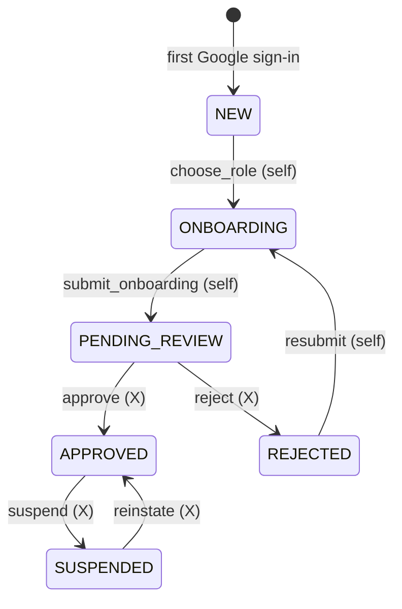
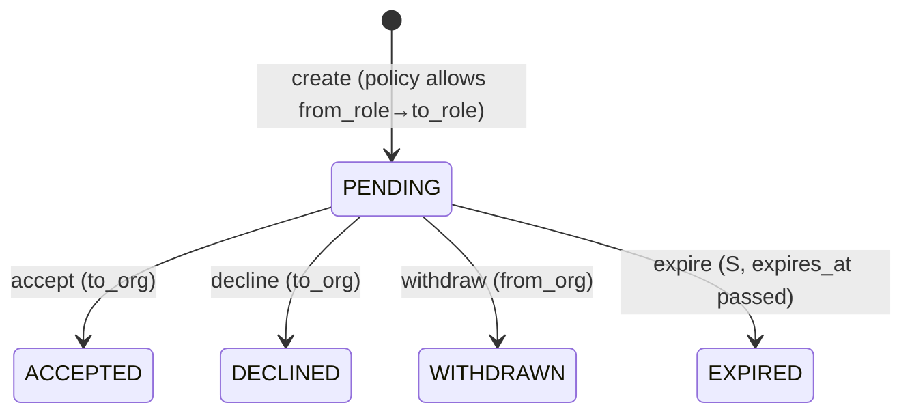
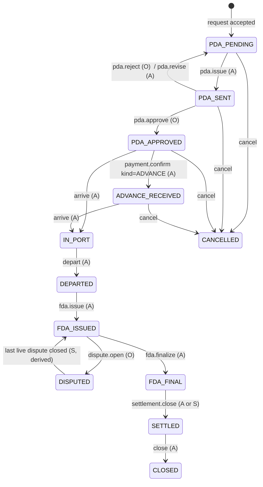
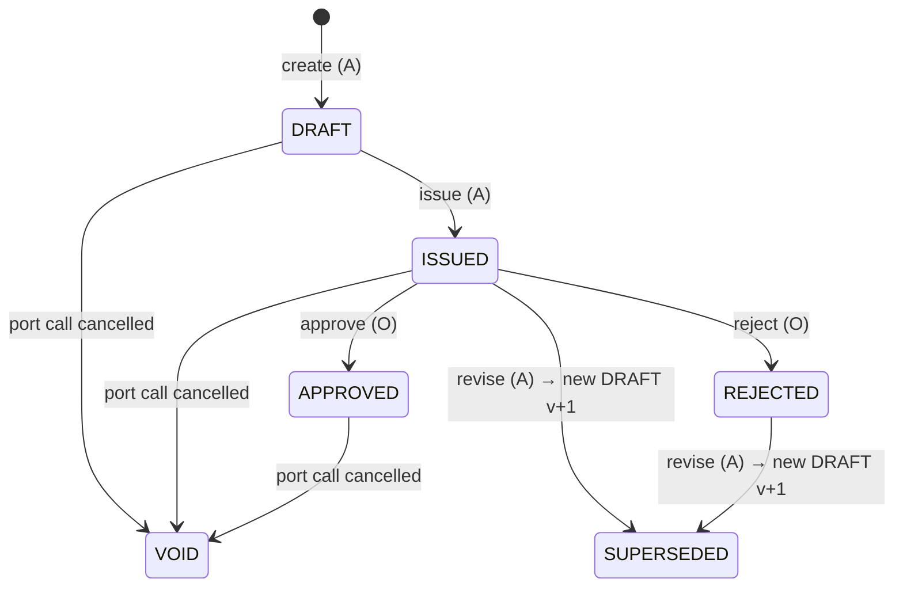
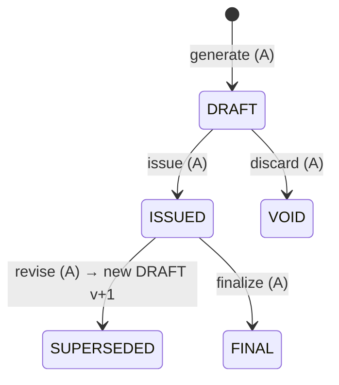
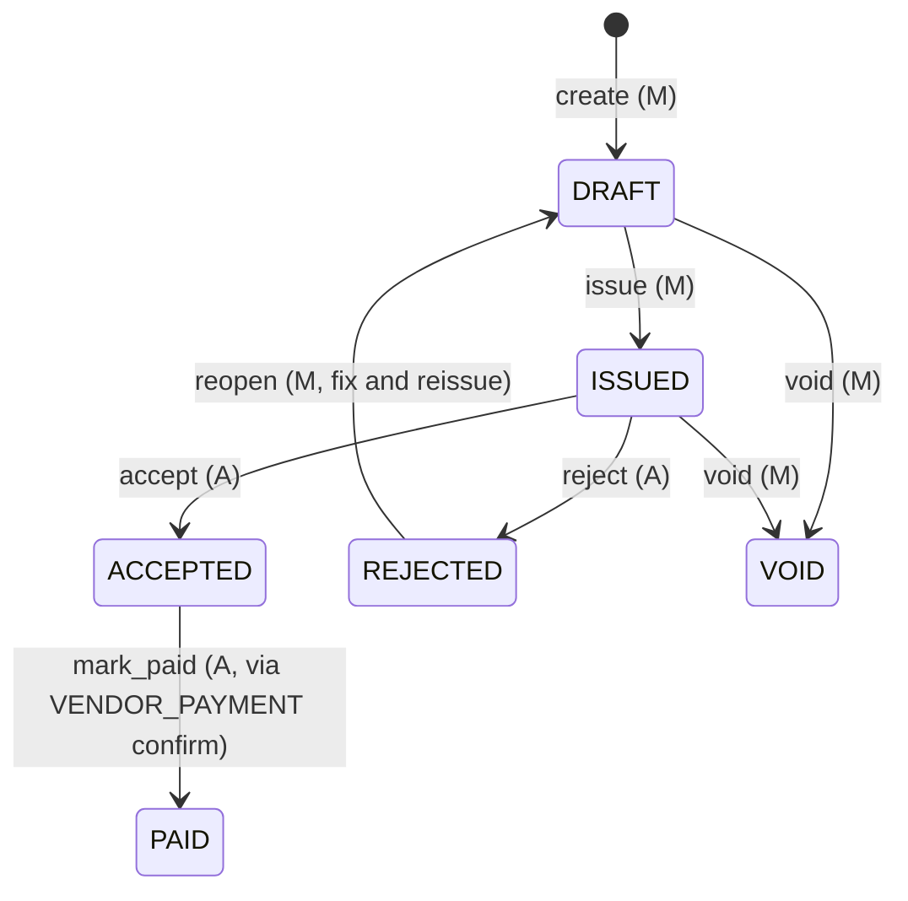
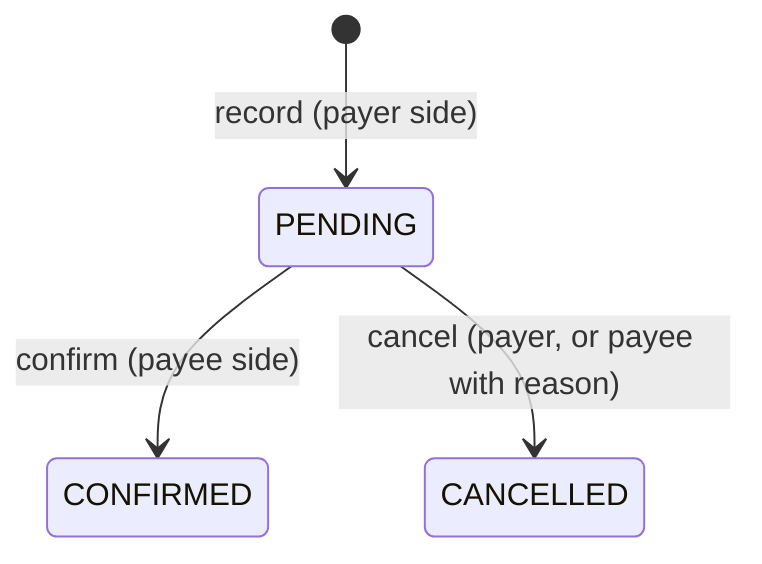
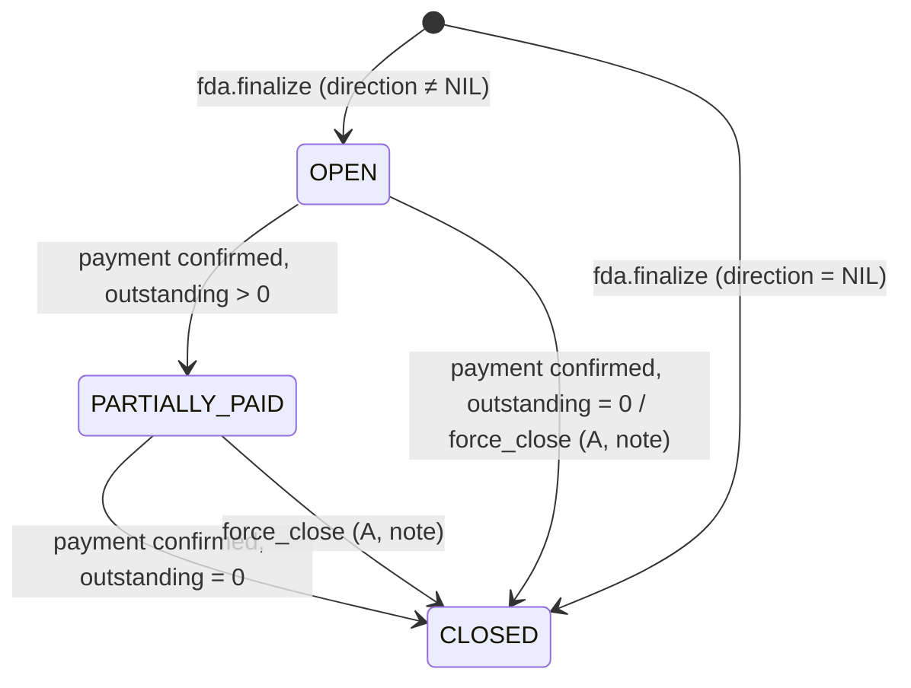
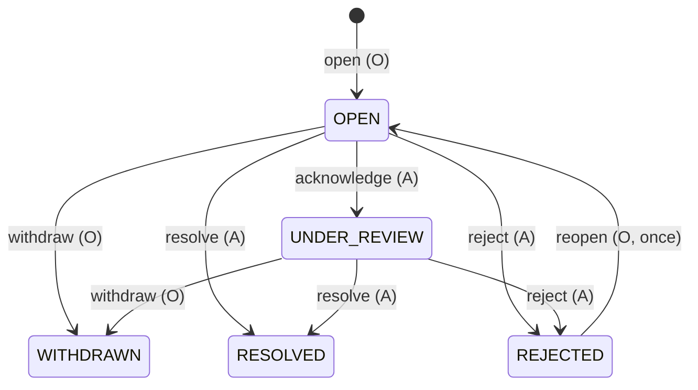

# STATE_MACHINES.md

Status: Phase 1 design. Each machine below is implemented as a transition table in
`<app>/transitions.py` and a test asserts the code table equals this document. Every transition is
a service function (`services.py`) that: checks permission → locks the aggregate row
(`select_for_update`) → validates guards → mutates → writes `audit_log` → returns. All inside
`transaction.atomic`.

Legend: **Actor** = who may trigger (O owner, A agent, M merchant, X admin, S system).
**Guard** = must be true. **Effects** = other rows touched in the same transaction.

---

## 1. User onboarding (`users.status`)

| Transition | Actor | Guard | Effects |
|---|---|---|---|
| choose_role | self | status=NEW; role ∈ {OWNER, AGENT, MERCHANT} | creates org (DRAFT) + matching profile + membership |
| submit_onboarding | self | status=ONBOARDING; org profile complete (required fields per role, ≥1 port, ≥1 verification doc) | org.verification_status → PENDING_REVIEW, `submitted_at` |
| approve | X | status=PENDING_REVIEW | org.verification_status → APPROVED (if PENDING_REVIEW); all PENDING docs stay as reviewed individually |
| reject | X | status=PENDING_REVIEW; reason required | org → REJECTED with note |
| resubmit | self | status=REJECTED | org → DRAFT |
| suspend / reinstate | X | — | org stays as is |

Admin-created users (`POST /admin/organizations/{id}/users`) are inserted directly as APPROVED with
`firebase_uid NULL`; first sign-in links by verified email. Admins are created only by the
`bootstrap_admin` management command or by another admin.

**Organization `verification_status`** follows the same shape: DRAFT → PENDING_REVIEW → APPROVED | REJECTED → (DRAFT on resubmit); APPROVED ↔ SUSPENDED.
**Verification document `status`**: PENDING → APPROVED | REJECTED (X). Rejecting a document does not by itself reject the user; the admin decides at user level.

---

## 2. Request (`requests.status`) — generic, both types

| Transition | Actor | Guard | Effects |
|---|---|---|---|
| create | from_org member | `request_role_policies(type, from_role, to_role).is_enabled`; both orgs APPROVED; PORT_CALL: vessel belongs to from_org, port active, to_org serves port (warn only), ETD>ETA; VENDOR_SERVICE: port_call belongs to from_org (agent), port call status ∉ {FDA_FINAL, SETTLED, CLOSED, CANCELLED}, to_org is MERCHANT | detail rows, request_services |
| accept | to_org member | status=PENDING | **PORT_CALL**: create `port_calls` (status PDA_PENDING, copy details, reference), set `requests.port_call_id`, create PORT_CALL chat thread {owner, agent}. **VENDOR_SERVICE**: create VENDOR_SERVICE chat thread {agent, merchant}. Sets `to_user_id`, `responded_at` |
| decline | to_org member | status=PENDING; note optional | `responded_at` |
| withdraw | from_org member | status=PENDING | — |
| expire | S (cron/command) | PENDING and now > expires_at | — |

ACCEPTED, DECLINED, WITHDRAWN, EXPIRED are terminal. A declined/withdrawn port-call request can simply be re-sent as a new request.

---

## 3. Port call (`port_calls.status`)

| Transition | Actor | Guard | Effects |
|---|---|---|---|
| pda.issue | A | status=PDA_PENDING; current PDA is DRAFT with ≥1 line | PDA → ISSUED |
| pda.approve | O | status=PDA_SENT | PDA → APPROVED |
| pda.reject | O | status=PDA_SENT; reason required | PDA → REJECTED; port call → PDA_PENDING |
| pda.revise | A | status=PDA_SENT (owner hasn't answered) | PDA ISSUED → SUPERSEDED; new DRAFT v+1; port call → PDA_PENDING |
| advance confirmed | A (payee confirm) | status ∈ {PDA_APPROVED, ADVANCE_RECEIVED}; payment.kind=ADVANCE | first confirmed advance moves PDA_APPROVED → ADVANCE_RECEIVED; later advances keep status |
| arrive | A | status ∈ {PDA_APPROVED, ADVANCE_RECEIVED}; `ata` provided | sets `ata`; if no confirmed advance, audit metadata flags `advance_missing=true` (allowed, visible on dashboard) |
| depart | A | status=IN_PORT; `atd ≥ ata` | sets `atd` |
| fda.issue | A | status=DEPARTED or (FDA_ISSUED after revise, see §4); current FDA DRAFT with ≥1 line | FDA → ISSUED |
| dispute.open | O | status=FDA_ISSUED (or DISPUTED) | → DISPUTED if not already |
| disputes all closed | S (inside dispute resolve/reject/withdraw) | no dispute on this call in {OPEN, UNDER_REVIEW} | DISPUTED → FDA_ISSUED |
| fda.finalize | A | status=FDA_ISSUED; zero live disputes; current FDA ISSUED | FDA → FINAL; **create settlement** (snapshot); status → FDA_FINAL; if settlement.direction=NIL, settlement → CLOSED and port call → SETTLED immediately |
| settlement.close | A, or S when outstanding hits 0 on payment confirm | status=FDA_FINAL; settlement outstanding = 0 (A may force-close with a note for written-off remainders ≤ configured tolerance, default 0) | settlement → CLOSED; status → SETTLED |
| close | A | status=SETTLED | `closed_at`; `agent_profiles.completed_port_calls += 1`; ratings now open |
| cancel | A or O (O only while PDA_PENDING/PDA_SENT); X any pre-arrival state | status ∈ {PDA_PENDING, PDA_SENT, PDA_APPROVED, ADVANCE_RECEIVED}; reason required | current PDA → VOID; pending vendor requests → WITHDRAWN; any CONFIRMED advance ⇒ a REFUND settlement is created manually by agent (out of scope for auto; flagged in audit) |
| agent edits (eta/etd/berth/notes) | A | status ∉ {FDA_FINAL, SETTLED, CLOSED, CANCELLED} | audit `changes` |

Dashboard pipeline columns map to statuses: Requested (= PENDING requests, not port calls) → PDA sent (PDA_PENDING, PDA_SENT) → Advance received (PDA_APPROVED, ADVANCE_RECEIVED) → In port (IN_PORT, DEPARTED) → FDA issued (FDA_ISSUED) → Disputed (DISPUTED) → Settled (FDA_FINAL, SETTLED, CLOSED).

---

## 4. Disbursement account — PDA and FDA (`disbursement_accounts.status`)

### 4a. PDA

| Transition | Actor | Guard | Effects |
|---|---|---|---|
| create | A | port call PDA_PENDING; no current PDA, or current is REJECTED/SUPERSEDED | v1 DRAFT with `agency fee` line pre-filled from `agent_profiles.default_agency_fee_*` if set |
| edit lines (replace set) | A | status=DRAFT | recompute `total_amount` |
| issue | A | DRAFT; ≥1 line; all lines `amount` consistent | `issued_at`; port call → PDA_SENT |
| approve | O | ISSUED | `owner_responded_*`; port call → PDA_APPROVED |
| reject | O | ISSUED; note required | port call → PDA_PENDING |
| revise | A | ISSUED or REJECTED | old → SUPERSEDED (`is_current=false`), new DRAFT copies lines with `supersedes_line_item_id`; port call → PDA_PENDING |

An APPROVED PDA is immutable in v1 (changes show up as FDA variance). See PROGRESS.md open question Q3 for "PDA supplement after approval".

### 4b. FDA

| Transition | Actor | Guard | Effects |
|---|---|---|---|
| generate | A | port call DEPARTED (or FDA_ISSUED with no current non-superseded FDA); no current FDA in DRAFT/ISSUED | Builder: one line per ACCEPTED vendor invoice (category, vendor, local amount/currency, FX applied → USD) + one AGENCY_FEE line copied from PDA (or profile default) + any PDA lines with category not covered by an invoice are **not** auto-added (agent adds manually, e.g. port dues paid by agent). Each line auto-linked to the PDA line with the same `service_category_id` (first unmatched). `fx_policy_note` records rule: "latest rate as_of ≤ ATD per pair" or explicit rate id. |
| edit lines | A | DRAFT | agent may add lines (agent-paid costs: port dues, customs), change PDA links, change FX rate per line (must reference an `fx_rates` row), cannot edit `local_amount` of invoice-backed lines (it's the invoice total) |
| issue | A | DRAFT; ≥1 line; every invoice-backed line's invoice is ACCEPTED | `issued_at`; port call → FDA_ISSUED |
| accept (optional signal) | O | ISSUED | `owner_responded_*` = accepted; no status change |
| revise | A | ISSUED (typically to resolve disputes) | old → SUPERSEDED; new DRAFT v+1 copies lines (`supersedes_line_item_id`); live disputes keep pointing at old lines until resolved; port call stays DISPUTED/FDA_ISSUED |
| finalize | A | ISSUED; **no dispute on the port call in {OPEN, UNDER_REVIEW}**; owner has had the FDA for ≥ `FDA_DISPUTE_WINDOW_DAYS` (default 0 = no wait) unless owner accepted | FDA → FINAL; settlement created; port call → FDA_FINAL |
| discard | A | DRAFT, version > 1 | new draft VOID; previous version regains `is_current=true` and ISSUED status is unchanged |

PDF rendering: allowed for ISSUED, APPROVED, REJECTED, SUPERSEDED, FINAL (cached per status). DRAFT renders a "DRAFT" watermark preview, not cached.

---

## 5. Vendor invoice (`vendor_invoices.status`)

| Transition | Actor | Guard | Effects |
|---|---|---|---|
| create | M | merchant has an ACCEPTED VENDOR_SERVICE request on the port call (or admin-linked); port call status ∉ {FDA_FINAL, SETTLED, CLOSED, CANCELLED} | `agent_organization_id` copied |
| issue | M | DRAFT; `file_id` set; totals consistent | — |
| accept | A | ISSUED | invoice becomes eligible for FDA builder; if current FDA is DRAFT, builder may be re-run (`regenerate`) |
| reject | A | ISSUED; note required | — |
| reopen | M | REJECTED | back to DRAFT (same number) |
| mark_paid | A | ACCEPTED; a CONFIRMED `payments` row kind=VENDOR_PAYMENT exists for it (or agent records one in same call) | `paid_at` |
| void | M | DRAFT or ISSUED (not yet accepted) | — |

An ACCEPTED invoice referenced by an ISSUED/FINAL FDA line cannot be changed; to correct it the vendor issues a credit/new invoice and the agent revises the FDA.

---

## 6. Payment (`payments.status`)

| kind | recorded by | confirmed by | guard on record |
|---|---|---|---|
| ADVANCE | O | A | port call ∈ {PDA_APPROVED, ADVANCE_RECEIVED, IN_PORT, DEPARTED}; `disbursement_account_id` = current APPROVED PDA |
| BALANCE | O | A | settlement OPEN/PARTIALLY_PAID, direction=BALANCE_DUE, amount ≤ outstanding |
| REFUND | A | O | settlement OPEN/PARTIALLY_PAID, direction=REFUND_DUE, amount ≤ outstanding |
| VENDOR_PAYMENT | A | (auto-confirmed by A; merchants see it) | invoice ACCEPTED |

Effects on confirm: ADVANCE → port call may move to ADVANCE_RECEIVED; BALANCE/REFUND → settlement
status recomputed (OPEN → PARTIALLY_PAID → CLOSED when outstanding = 0, which also moves the port
call to SETTLED); VENDOR_PAYMENT → invoice PAID. Only CONFIRMED payments count anywhere.
Admin may confirm/cancel any payment (support path), audited.

---

## 7. Settlement (`settlements.status`)

Math (Decimal, account currency):
`balance = fda_total − advance_total`; `direction` from sign; `outstanding = |balance| − Σ CONFIRMED payments(kind ∈ {BALANCE, REFUND}, settlement_id = this)`.
Over-payment is rejected at record time (amount ≤ outstanding). Settlement statement PDF is cached at CLOSED, preview otherwise.

---

## 8. Dispute (`disputes.status`)

| Transition | Actor | Guard | Effects |
|---|---|---|---|
| open | O | line belongs to the port call's current FDA; FDA status=ISSUED; no live dispute on that line; reason required | `dispute_events(OPENED)`; port call → DISPUTED |
| comment | O or A | status ∈ {OPEN, UNDER_REVIEW} | `dispute_events(COMMENT)` (file optional) |
| acknowledge | A | OPEN | event STATUS_CHANGED |
| resolve (EXPLAINED) | A | OPEN/UNDER_REVIEW; note required | `resolution_type=EXPLAINED`; close; recompute port call status |
| resolve (ADJUSTED) | A | OPEN/UNDER_REVIEW; `adjusted_local_amount` given | if current FDA is ISSUED → `fda.revise` first (new DRAFT), then the matching line (via `supersedes_line_item_id`) gets `local_amount` changed **or** an `is_adjustment` credit line is added (agent's choice, default: change the line, keep original visible via version history); dispute gets `resolved_in_account_id`, `adjustment_line_item_id`; close. The agent then re-issues the FDA (§4b) |
| reject | A | OPEN/UNDER_REVIEW; note required | close with `resolution_type=REJECTED` |
| withdraw | O | OPEN/UNDER_REVIEW | close with `resolution_type=WITHDRAWN` |
| reopen | O | REJECTED; `reopen_count = 0`; FDA not FINAL | `reopen_count=1`; status OPEN; `resolved_*` cleared; event REOPENED; port call → DISPUTED |

"Close" = set `resolved_at`, `resolved_by`, event STATUS_CHANGED; then if no live disputes remain on
the port call and status=DISPUTED → FDA_ISSUED. Every event is also mirrored to `audit_log`.

---

## 9. Chat thread (`chat_threads.is_closed`)

Created on request acceptance (both kinds). `is_closed` set when the port call reaches CLOSED or
CANCELLED (messages become read-only). Not a full state machine; listed for completeness.

---

## 10. Cross-machine guards (the ones tests must cover)

1. `fda.finalize` blocked while any dispute on the call is OPEN/UNDER_REVIEW.
2. `dispute.open` only on a line of the **current ISSUED** FDA.
3. `pda.approve/reject` only by the port call's owner org; `fda.*`, `arrive`, `depart` only by its agent org.
4. Advance recording requires an APPROVED current PDA.
5. Vendor invoice creation requires an ACCEPTED vendor request from that merchant on that call.
6. Settlement is created exactly once per port call (UNIQUE) and only by `fda.finalize`.
7. Port call status recomputation after dispute close is idempotent.
8. Cancelling a port call voids the current PDA, withdraws pending vendor requests, closes chat.
9. Request creation respects `request_role_policies`; disabling a row makes `create` raise `PolicyDenied`.
10. All of the above write exactly one `audit_log` row per transition (dispute events may write two: event + audit).
